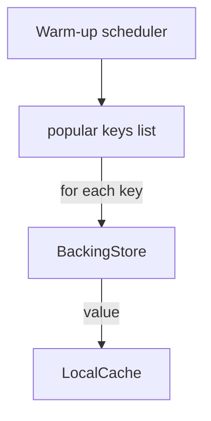

# lru-cache

This document provides an industry-oriented system design for an LRU (Least Recently Used) cache. It focuses on architecture, operational considerations, real-world usage examples, metrics, scaling, and trade-offs. It intentionally does not include implementation code — we'll generate source files separately when you're ready.

## Table of contents

- Overview
- When to use LRU (industry examples)
- Goals, constraints, and non-goals
- Core API and semantics
- System components and high-level architecture
- Eviction strategy rationale and alternatives
- Capacity planning and sizing examples
- Distributed designs and scaling patterns
- Operational concerns: metrics, monitoring, and SLAs
- Failure modes and mitigation
- Flow diagrams (Mermaid)
- Next steps

## Overview

An LRU cache is an in-memory store that keeps a bounded number of items and evicts the least recently used item when capacity is exceeded. LRU is a good fit when the working set exhibits temporal locality (recently accessed items are likely to be accessed again).

This document treats the cache as a component within larger systems (web services, CDNs, databases) and explains how to design it for production use.

## When to use LRU (industry examples)

1. API response caching at the application edge
   - Cache recent API responses to reduce backend load and latency for high-read traffic.
   - Example: caching user profile fetches for interactive web requests.

2. Database query result caching
   - Cache expensive read-only query results to reduce DB CPU/IO.
   - Example: denormalized read model or report queries where freshness requirements are relaxed.

3. CDN / Edge cache (per-node LRU)
   - Each edge node keeps limited local storage; LRU keeps most recently requested objects nearby.

4. In-memory feature cache for ML inference
   - Cache recent feature vectors or model outputs to reduce computation on hot items.

5. Session or token caches (short-lived)
   - Cache authentication tokens or session blobs to avoid repeated store lookups.

Industry note: For high-concurrency and large-scale systems prefer battle-tested cache libraries (Caffeine, Redis, memcached) or commercial CDN caches rather than naive home-grown implementations.

## Goals, constraints, and non-goals

Goals:
- Provide bounded memory usage (capacity limit).
- Fast operations for common paths (get, put, peek).
- Deterministic eviction (LRU policy).
- Clear operational metrics (hit/miss, evictions).

Constraints:
- Works in-memory on a single process or node by default.
- Consistency between map and usage-order must be maintained.

Non-goals:
- Strong global consistency across many distributed nodes (LRU is primarily a local policy).
- Long-term persistence — caches are ephemeral by nature.

## Core API and semantics

An industry-standard minimal API (language-agnostic):
- get(key): returns value or miss. Updates usage order.
- put(key, value): insert or update; updates usage order and may trigger eviction.
- peek(key): read without changing usage order (useful for monitoring or special cases).
- remove(key): force remove from cache.
- clear(): empty the cache.
- meta/stats(): return metrics (hits, misses, evictions, size, capacity).

Optional extensions:
- putWithTTL(key, value, ttl): combine LRU and time-based expiry.
- putIfAbsent, computeIfAbsent: atomic helpers to avoid stampedes.

API semantics to define explicitly:
- What constitutes an access that counts for LRU ordering (get, put, peek?).
- Return semantics on miss (null vs Optional vs exception) and whether there is a backing load mechanism.

Cache-aside vs write-through vs write-behind patterns (choose per consistency/performance needs):
- Cache-aside (lazy load): application checks cache then loads from backing store on miss and populates cache. Simple, commonly used.
- Write-through: writes update the cache and backing store synchronously. Simpler consistency but higher write latency.
- Write-behind: writes return quickly and are persisted asynchronously; risk of lost updates on failure.

## System components and high-level architecture

Single-node (in-process) cache:
- In-memory data structures: hashmap for key → entry, plus an order structure to track recency.
- Cache manager: instrumentation, eviction trigger, TTL sweeper (if TTL used).
- Optional loader: function to fetch values on miss.

Service architecture examples:
- Monolithic app: single-process LRU for per-instance caching.
- Microservices: each instance has local LRU for hottest items + a distributed cache for shared large working sets.

Design pattern: Typical deployment in front of the data source (cache-aside):
- Client → Service (local LRU) → (if miss) → backing store (DB/remote cache/CDN) → Service (populate cache) → Client

Consider centralizing metrics and health via an exporter (Prometheus) and expose endpoints for cache stats.

## Eviction strategy rationale and alternatives

Why LRU?
- Simple, easy to reason about, and effective when access patterns have temporal locality.
- Deterministic and memory-bounded.

Alternatives and when to choose them:
- LFU (Least Frequently Used): better for long-term popularity tracking; more stateful and often more costly to maintain.
- TinyLFU + LRU (e.g., Window TinyLFU in Caffeine): economical and better hit rates; recommended for large caches.
- CLOCK: approximation of LRU with less overhead — used in OS-level page replacement.
- Random or FIFO: sometimes acceptable for simple or write-heavy workloads.

Industry practice: prefer well-tested cache implementations (e.g., Caffeine), which implement advanced hybrid policies like Window-TinyLFU to get better hit rates than pure LRU while keeping complexity manageable.

## Capacity planning and sizing examples

Key inputs:
- Average entry size (S bytes) including overhead (object headers, pointers)
- Target resident items (N)
- Memory budget (M bytes)

Simple sizing formula:
- N = floor(M / S)
- Choose capacity = N * safety_factor (e.g., 0.9) to leave headroom for GC and overhead.

Example:
- Memory budget: 512 MB (536,870,912 bytes)
- Average entry size: 2 KB (2048 bytes)
- Maximum entries ≈ 536,870,912 / 2048 ≈ 262,144 entries
- Choose capacity = 240,000 to leave headroom for JVM overhead and fragmentation.

Monitoring tip: measure actual object sizes (heap profiling) and account for load factor in hash maps and linked-list overhead.

Eviction tuning:
- Eviction triggers on insert when size > capacity. Consider soft limits and background trimming to avoid long pauses.
- For large entries, consider weighted capacity (sum of weights) rather than count-based capacity.

## Distributed designs and scaling patterns

Local caches per instance:
- Pros: ultra-low latency, reduces cross-node network calls.
- Cons: cache duplication, cold-starts, inconsistent views across nodes.

Shared distributed cache (e.g., Redis, Memcached):
- Pros: single source of truth, easier to control global capacity.
- Cons: network hop, operational complexity, and possible single points of failure.

Sharding approaches:
- Client-side sharding (consistent hashing): distribute keys across cache nodes to scale capacity and throughput.
- Centralized clustering: use a distributed cache with built-in clustering and replication.

Approximating LRU in distributed caches:
- Global precise LRU is expensive. Instead use local LRU per shard or the distributed cache's internal eviction.
- Consider lightweight frequency sketches (TinyLFU) to approximate popularity across nodes.

Cache coherence & consistency:
- Cache invalidation: for write-heavy workloads, ensure invalidation is synchronous or use short TTLs.
- Use message bus (Kafka) to broadcast invalidation events to nodes when underlying data changes.

Example hybrid architecture:
- Local LRU per instance for ultra-fast hits + Redis as a shared cache for larger or less frequently accessed items. Use a cache-aside pattern with backing store as the authoritative source.

## Operational concerns: metrics, monitoring, and SLAs

Essential metrics to expose:
- hit_count, miss_count, hit_rate
- eviction_count, current_size, capacity
- average_latency_get, p95_latency_get
- load_success_count, load_failure_count (if async loader used)

Health and alerts:
- Alert on sudden increase in miss rate or eviction rate.
- Alert on memory pressure or GC spikes if cache grows unexpectedly.

Instrumentation tips:
- Add Prometheus exporters for metrics.
- Track sizes of entries and distribution to detect heavy entries.
- Enable runtime dumping of top hot keys for debugging (careful with privacy/security).

SLA considerations:
- Define acceptable staleness (TTL) and miss penalties.
- Consider fallbacks for the cache being unavailable (graceful degradation).

## Failure modes and mitigation

1. Memory exhaustion / OOM
   - Use strict capacity limits, use eviction on insert, and consider eviction in background.
   - Set process-level memory limits and monitor memory usage.

2. Cache stampede (many clients miss same key)
   - Use request coalescing / singleflight to ensure only one load is in-flight for a missing key.
   - Use early recomputation or autoscaling of the backing store.

3. Inconsistent data after writes
   - Use explicit invalidation (synchronous) or rely on TTLs for eventual consistency.
   - For critical data, consider write-through or transactional updates.

4. Hot keys
   - Detect hot keys and handle them specially (pinning, replication, or bypass to dedicated store).

5. Serialization / object-bloat
   - Ensure cached objects are memory-efficient and prefer compact serialized forms for shared caches.

## Flow diagrams (Mermaid)

Request/response with local LRU (cache-aside):

```mermaid
flowchart TD
  Client --> Service[Service Instance]
  Service -->|get(key)| LocalCache[Local LRU Cache]
  LocalCache -->|hit| ServiceReturn[Return value]
  LocalCache -->|miss| Backing[Backing Store / Remote Cache]
  Backing -->|value| Service
  Service -->|populate cache| LocalCache
  Service -->|return| Client
```

Eviction lifecycle (single-node):

```mermaid
flowchart TD
  Put[put(key,value)] --> Check{size > capacity?}
  Check -- No --> AddToCache[insert at MRU]
  Check -- Yes --> Evict[remove LRU entry]
  Evict --> AddToCache
```

Cache warm-up and prefetching example:



## Next steps

I removed all code from the README and focused it into an industry-standard system design document with practical examples and operational guidance. Next, I can:

- Generate a project skeleton (Maven or Gradle) and place interface definitions and tests in the repository.
- Produce multiple cache variants as separate modules: in-process LRU, weighted-LRU, TTL-LRU, and a LinkedHashMap-based thin wrapper.
- Create an architecture diagram (draw.io or higher-fidelity) and embed/export it for the repo.

Which of the next steps would you like me to do now?